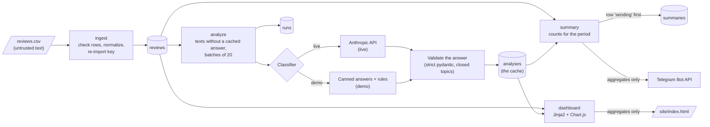
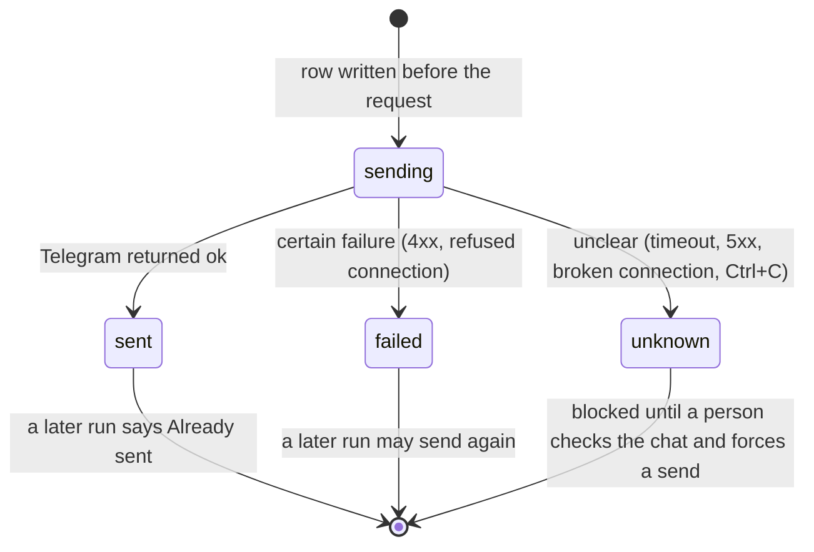
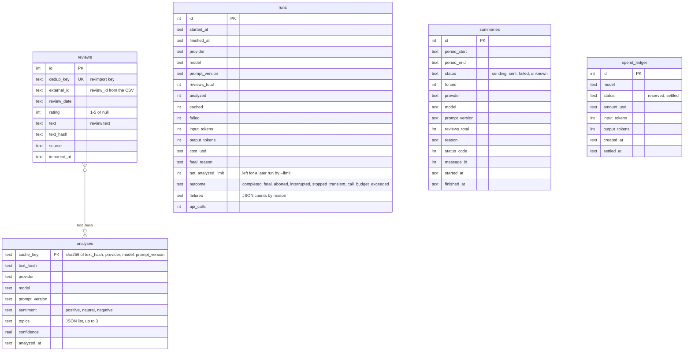
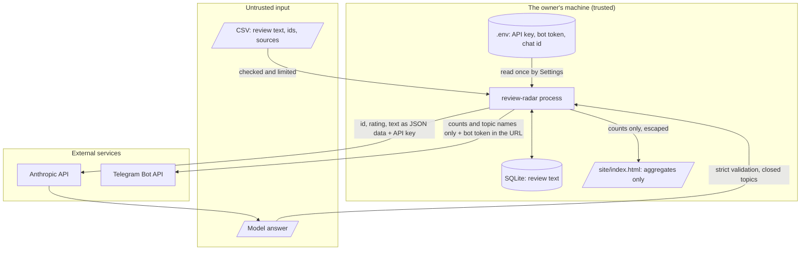

# Architecture

Review Radar is a command-line pipeline. There is no web server. Each command reads from and
writes to one local SQLite database. The reasons for each decision are in [PLAN.md](PLAN.md).

## Modules

All code is in `src/review_radar/`.

| Module | Job |
|---|---|
| `cli.py` | The Typer commands: `ingest`, `analyze`, `summary`, `dashboard`, `run`, `eval`. |
| `config.py` | `Settings`: reads `.env` from the repository root; keys are `SecretStr`. |
| `ingest.py` | Reads and checks the CSV. Bad rows are counted, not fatal. |
| `models.py` | Pydantic models: `Review`, `Analysis`, the closed lists of sentiments and topics. |
| `hashing.py` | Text normalization, `text_hash`, `cache_key`, the re-import key. |
| `storage.py` | The SQLite schema and every query. |
| `classifier.py` | The `Classifier` protocol and the shared result types. |
| `anthropic_classifier.py` | Live classifier: structured output, validation, retries, error reasons. |
| `fixture_classifier.py` | Demo classifier: canned answers plus simple rules. No network. |
| `analysis.py` | Finds texts without a cached answer, makes batches of 20, saves the answers. |
| `pricing.py` | The price table and the cost estimate. |
| `summary.py` | Counts for a period and the Telegram message. |
| `telegram.py` | Sends one message to the Telegram Bot API. |
| `dashboard.py` | Builds `site/index.html` from a Jinja2 template. |
| `evaluation.py` | Scores answers against ground truth; the spend guard for `eval`. |

## Data flow



1. **Import.** `ingest` reads the CSV and checks each row (date, text length up to 2,000 characters,
   rating 1 to 5, a file up to 20 MB). A bad row is counted with its line number and reason and
   then skipped. Each review gets a re-import key, so the same row is stored once. The source plus
   `review_id` make the key; without an id, a hash of the date, the text and the source does.
2. **Classification.** `analyze` collects the texts that have no row in `analyses` for the current
   classifier. Reviews with the same normalized text share one answer. The texts go out in batches
   of 20, each with a short id (`r1` to `r20`). Only the id, the rating and the text are sent.
   Every answer is checked with strict pydantic models before it is saved.
3. **Storage.** Valid answers are saved in `analyses` and act as the cache. Failed reviews are not
   saved, so the next run tries them again. Each `analyze` run writes one row to `runs`, also when
   it fails or is interrupted.
4. **Summary.** `summary` counts the reviews of a day or a period and takes the top 3 topics of the
   negative reviews. It writes a `sending` row to `summaries` before the request, then sends the
   message and records the result.
5. **Dashboard.** `dashboard` builds one static page with the counts per day and per topic. The
   page reads no data from the network.

### The cache key

An answer is stored under `cache_key`, the sha256 of a JSON array:
`[text_hash, provider, model, prompt_version]`.

- `text_hash` is the sha256 of the normalized text (Unicode NFC, collapsed spaces, case folded).
- `prompt_version` for the live classifier is `anthropic-1+<sha8 of the prompt and the schema>`.
  A change to the prompt or the schema is a cache miss.
- In demo mode the version is `fixture-1+<sha8>` of the canned answers and the rules. So demo
  answers never mix with live answers, and a change to the rules is a cache miss.

### Sending a summary at most once



The row is claimed inside one `BEGIN IMMEDIATE` transaction, so two runs cannot both send the same
period. A send is never retried inside a run.

## Database schema

The schema version is kept in `PRAGMA user_version` (now 6). One idempotent script creates every
table. An older database (version 2 or later) is upgraded by running the same script again. There
are no foreign keys: the tables are linked by `text_hash` and by the classifier key (provider,
model, prompt version).



`spend_ledger` is used by `eval`. Before each call it reserves the worst-case cost. After the call
it replaces that with the real cost. A crash can overstate the total but never understate it.

To see the schema version of the demo database after `uv run review-radar run --demo`:

```bash
uv run python -c "import sqlite3; print(sqlite3.connect('data/review_radar-demo.db').execute('PRAGMA user_version').fetchone()[0])"
```

It prints `6`.

## Trust boundaries



**Review text (CSV to the process).** Every review is untrusted.

- The file size, the text length, the date and the rating are checked. Broken CSV quoting either
  skips one row or rejects the file.
- Review text never appears in logs, error messages, the Telegram message or the dashboard. Only
  counts, line numbers and reason codes do.

**Review text to the model, and the answer back.** The text is sent as JSON data. The system
prompt is static and says to treat the text as data.

- The answer is untrusted too. It is parsed and validated with strict pydantic models. Answers
  for ids that were not asked are ignored. A topic outside the closed list becomes `other`, and
  more than three topics are cut to three (`other` is dropped first); both are counted in the run report. Bad JSON, a schema violation, duplicate
  ids or a truncated answer reject the batch, which is then split in half and retried.
- What validation cannot catch is a wrong but well-formed answer. A crafted review can steer the
  labels of other reviews in its batch. This prompt injection risk is accepted and documented
  (see [PLAN.md](PLAN.md), "Prompt injection").

**Secrets.**

- The API key, the bot token and the chat id live only in `.env`, which git ignores. `Settings`
  reads them as `SecretStr`. The key is unwrapped once, to build the SDK client.
- The bot token is part of the Telegram URL, so the HTTP loggers stay at WARNING, and errors carry
  only a reason and a status code.
- A gitleaks pre-commit hook and a gitleaks job in CI scan for secrets. The CI scan covers the full
  history.

**Anthropic API.**

- Outbound HTTPS only. It gets the id, the rating and the text, not the source or the date.
- Calls are bounded by retries with backoff (up to 4 attempts, honouring `retry-after`), a circuit
  breaker (two batches in a row that failed only on temporary errors stop the run), a call budget
  per run, and the `--max-cost` limit for `eval`.
- In live mode the tool warns about SDK environment variables that could redirect requests or log
  request bodies (`ANTHROPIC_BASE_URL`, `ANTHROPIC_LOG=debug` and others).

**Telegram.**

- Send only: the bot does not read messages or commands, so nothing comes in from the chat.
- The message holds counts and topic names from the closed list, never review text. Every value is
  HTML-escaped. Demo answers are never sent.

**Dashboard.**

- The page holds counts only. Jinja2 autoescaping is on.
- The data is embedded with `tojson` in an `application/json` block, not in a script.
- A Content Security Policy allows only same-origin scripts, styles and images, with no inline
  code. Chart.js is vendored, so the page makes no network request.

**Local storage.** The database holds the full review text.

- A new database file is created owner-only (0600) in a 0700 folder on Linux and macOS. An older
  file that others can read gets a warning.
- `data/` is git-ignored, except the fictional sample and eval sets.

**CI.** The workflow uses no secrets.

- The token is read-only and checkout keeps no credentials.
- Actions are pinned to commit SHAs.
- The test jobs run in demo mode with blank keys.
